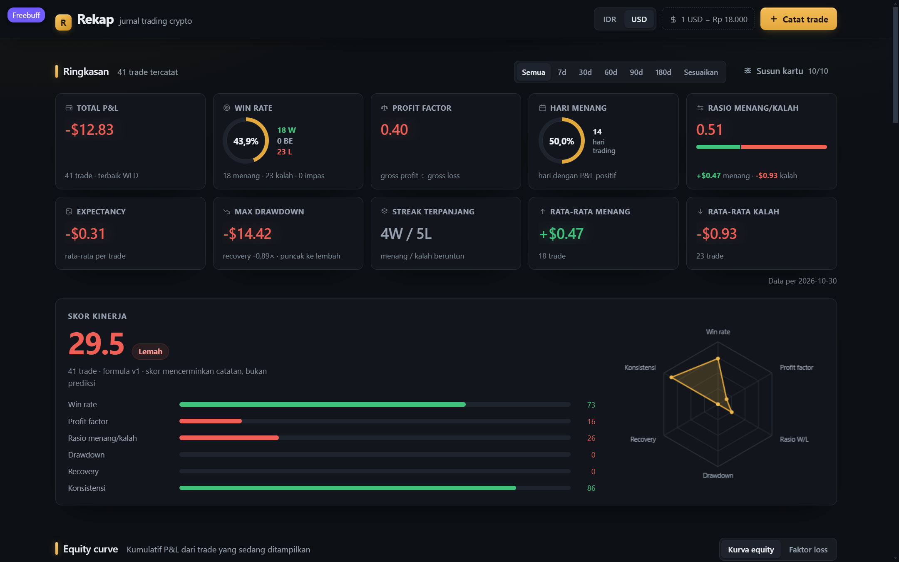
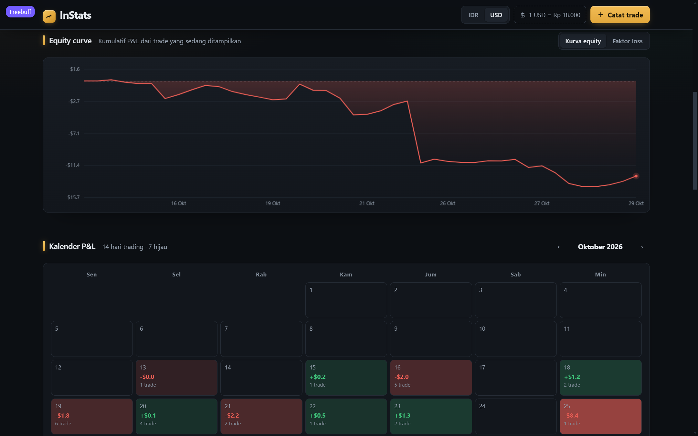
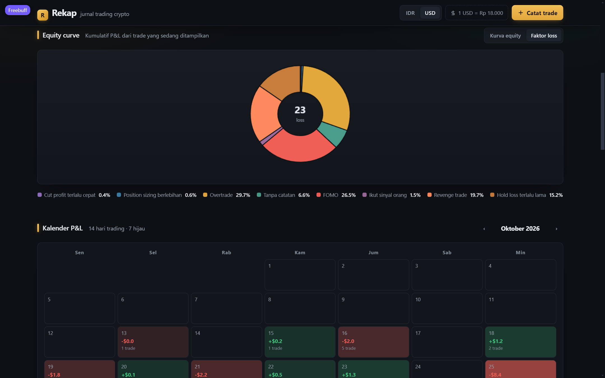

# 📊 Rekap Jurnal Trading Crypto

> **English:** A free, open-source crypto trading journal that runs fully local in your browser  no server, no account, no data leaves your machine. Track entries, exits, stop losses, setups, mistakes and emotions; get P&L, R-multiple, win rate, profit factor, expectancy, an equity curve, a loss-factor pie chart, a P&L calendar, and CSV import/export. Built with vanilla JS + Vite, MIT licensed.

Aplikasi jurnal trading crypto lokal (Vite, data tersimpan di **localStorage**). Semua proses berjalan di **localhost** komputermu sendiri — tidak ada data yang dikirim ke mana pun.



## ✅ Syarat

- **Node.js** versi 18 atau lebih baru → download gratis di [nodejs.org](https://nodejs.org) (pilih versi **LTS**)
- Browser apa saja (Chrome / Edge / Firefox)

## 🚀 Cara Menjalankan

### Cara A  Paling gampang (Windows)

Double-click file **`start.bat`**. Browser akan terbuka otomatis di `http://localhost:5173`.

### Cara B Manual (Windows / Mac / Linux)

1. Buka terminal (CMD / PowerShell / Terminal) di dalam folder proyek ini
2. Jalankan perintah berikut satu per:

```bash
# Install semua dependensi (hanya perlu sekali)
npm install

# Jalankan server lokal
npm run dev
```

3. Buka **http://localhost:5173** di browser

> Hasilnya seperti ini → `Local: http://localhost:5173/`

## 📌 Fitur

- Catat trade (long/short) dengan harga entry, exit, quantity, stop loss
- Hitung P&L, R-multiple, risk otomatis
- Dashboard ringkasan (total P&L, win rate, profit factor, expectancy)
- **Statistik per setup & per simbol** — jumlah trade, win rate, P&L, R-rata tiap kelompok
- **Statistik lanjutan**  performa per bulan (tabel tahunan), distribusi R-multiple (histogram), win rate 30 hari
- **Kalender P&L harian**  heatmap bulanan dengan navigasi ‹ ›
- Grafik equity curve kumulatif + diagram pie **faktor penyebab loss** (beranimasi)





- Filter trade (pencarian, arah, hasil, setup, **kesalahan**, **emosi**, rentang tanggal)
- **Ekspor CSV** sesuai filter aktif untuk Excel / Google Sheets
- **Impor CSV**  dukung format ekspor Rekap sendiri plus alias kolom umum (date/symbol/side/entry/exit/…), dengan deteksi duplikat
- **Edit massal**  centang banyak baris lalu ubah setup / kesalahan sekaligus
- **Hapus massal**  centang banyak baris (checkbox) lalu hapus sekaligus dengan satu konfirmasi
- **Kalkulator position sizing**  saldo, risiko %, entry & stop → qty ideal sebelum entry
- Data tersimpan di browser (localStorage)

## 💾 Backup & Pulihkan

- **⬇ Backup**  mengunduh seluruh jurnal sebagai `rekap-backup-YYYY-MM-DD.json`. Simpan file itu ke folder **`backup-log/`** sebagai cadangan manual.
- **⬆ Pulihkan**  pilih file backup; isi file **digabungkan** dengan jurnal saat ini (data yang sudah ada tidak hilang).
- **📁 Backup otomatis ke folder**  pilih folder sekali (File System Access API), lalu setiap perubahan trade otomatis tersimpan sebagai `rekap-backup-*.json` di folder itu tanpa dialog unduh.
- Kartu ini menampilkan **pengingat backup**: jika belum pernah backup atau terakhir lebih dari 7 hari lalu, muncul peringatan agar segera unduh file cadangan.

## ❓ Troubleshooting

| Masalah | Solusi |
| --- | --- |
| `npm` tidak dikenali | Node.js belum terinstall — install dulu dari [nodejs.org](https://nodejs.org) |
| Port 5173 sudah dipakai | Jalankan `npm run dev -- --port 3000`, lalu buka `http://localhost:3000` |
| Muncul error saat `npm install` | Hapus folder `node_modules` (jika ada) lalu jalankan `npm install` lagi |
| Data terlihat “hilang” | Data menempel ke URL persis `localhost:5173` — pastikan port tidak berubah (port dikunci di `vite.config.js`) |

## 📌 Catatan

- **Data jurnal** (trade, pengaturan, filter) tersimpan di **localStorage browser** masing-masing  tersimpan otomatis di browser yang kamu pakai.
- Aplikasi ini **tanpa server & tanpa akun**; tidak ada yang dikirim ke mana pun.
- Tidak butuh file `.env`  lihat `.env.example` untuk keterangan.

## 🔄 Update dari pemilik proyek

Jika kamu menerima versi baru, cukup **ganti file lama dengan yang baru** (boleh hapus folder lama dulu), lalu ulangi `npm install` dan `npm run dev`. Data jurnalmu aman di localStorage  untuk berjaga-jaga,unduh **Backup** sebelum update.

## 📄 Lisensi

[MIT](LICENSE)  bebas dipakai, dimodifikasi, dan didistribusikan.

---

Selamat trading! 🚀
